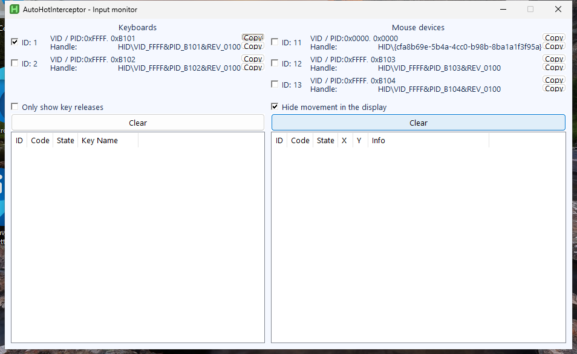

# AutoHotInterceptor

The matching Interceptor-Keyboard-Mouse demo driver source is available; see
[driver/README.md](driver/README.md) for build instructions and separate
evaluation-source terms. Those terms apply to Titan-authored driver code. Third-party
source licenses and existing application/SDK licenses remain applicable. Full/commercial
implementation and private signing or activation material are excluded.

Use **AutoHotkey v1 or v2** with the **Microsoft-signed Interceptor Keyboard & Mouse kernel filter driver**. Run different hotkeys on different keyboards, subscribe to mouse movement and buttons, block selected events, or forward modified input through the original Windows device path.

<!-- full-version-contact:start -->
> [!IMPORTANT]
> **Get the full driver version without demo restrictions**
>
> **Discord username: `titancsa`**
>
> Open Discord, choose **Friends > Add Friend**, enter **`titancsa`**, then send a direct message. Ask for the **full driver version without the demo time limit**, and mention **AutoHotInterceptor**.
>
> The demo limit belongs to **Interceptor Keyboard & Mouse**, the driver used by this project. Ask for pricing and the appropriate license / activation instructions; the application or wrapper source keeps its existing license.
<!-- full-version-contact:end -->

**[Download](https://github.com/TitanCSA/AutoHotInterceptor/releases/latest)** · [API guide](docs/API.md) · [Build and tests](docs/BUILD.md) · [Driver](https://github.com/TitanCSA/Interceptor-Keyboard-Mouse)

This is an adaptation of [evilC/AutoHotInterception](https://github.com/evilC/AutoHotInterception), by Clive Galway. It preserves the `AutoHotInterception` class and its subscription/context interfaces, using TitanCSA's driver instead of the original Interception DLL. Stock AutoHotkey remains unmodified: ordinary hotkeys, GUIs, timers and scripts still work normally.



## Start in three steps

1. Download **AutoHotInterceptor-1.0.0-win64.zip** and extract the **entire** ZIP.
2. Open **AutoHotInterceptor.exe** → **Install / repair driver**. Accept administrator approval and choose **Install / reinstall**. Restart Windows if setup requests it.
3. Select AutoHotkey v2 or v1, then **Open input monitor**. Check a device to observe it. Copy its VID/PID or hardware ID into a script, or start with **Remap A to B.ahk**.

The release already includes stock portable AutoHotkey runtimes, the managed wrapper, both native DLL architectures, examples and the driver installers. No Visual Studio, manual DLL assembly, COM registration or machine-wide AutoHotkey installation is needed. Windows supplies .NET Framework 4.8 on supported Windows 10/11 installations.

| Launcher action | Purpose |
| --- | --- |
| Install / repair driver | Opens the existing driver setup and diagnostics UI |
| Open input monitor | Lists individual devices, copies their IDs, displays key/button/movement events |
| Run a script | Runs an `.ahk` file with the selected stock runtime; administrator approval is requested |
| Examples and library | Opens that runtime's scripts and `Lib` folder |
| Uninstall driver | Restores the driver's Windows input associations with its own uninstaller |

The package itself is portable. Close its scripts before uninstalling the driver. Remove the extracted folder when it is no longer needed; other programs sharing this driver will also need it installed. The driver setup reports any required restart.

## Minimal AutoHotkey v2 script

Save this alongside the scripts in **AHK v2**. It changes A to B on the selected keyboard and leaves other keys untouched:

```autohotkey
#Requires AutoHotkey v2.0
#Include Lib\AutoHotInterception.ahk
Persistent
AHI := AutoHotInterception()
keyboard := AHI.GetKeyboardId(0x1234, 0x5678) ; Copy from Monitor.
AHI.SubscribeKey(keyboard, GetKeySC("a"), true, Remap)

Remap(state) {
    global AHI, keyboard
    AHI.SendKeyEvent(keyboard, GetKeySC("b"), state)
}
```

`state` is **1 for press**, **0 for release**. `block=true` suppresses the original A; the callback sends B. `block=false` observes the original event without suppressing it. Close the script to release capture. The bundled quick-start example automatically selects the first keyboard; edit its selection for another one.

For v1, use `AHI := new AutoHotInterception()` and `Func("Remap")` as the callback. The release includes complete v1 examples. Keep the correct version's `Lib` folder next to your script or place it in that version's AutoHotkey library directory.

## Features and compatibility

- Individual keyboards/mouse devices; VID/PID, duplicate-device instance and hardware-ID lookup.
- Single-key, whole-keyboard, individual-button, all-button and relative/absolute movement subscriptions.
- Optional blocking, sequential/concurrent callbacks, context-sensitive ordinary AutoHotkey hotkeys, unsubscribe and `SetState()`.
- Scan-code press/release synthesis, five mouse buttons, vertical/horizontal wheel, relative movement and absolute coordinates.
- x64 Windows 10 1709+ / Windows 11; x64 and Unicode x86 AutoHotkey v1.1 / v2 runtimes. ARM64 is not supplied.

Compatibility IDs remain **1–10 for keyboards** and **11–20 for mouse devices**, scoped to the current capture. A disconnected slot is never silently assigned to a different device. Reopen the script/monitor after device changes or sleep if necessary. Ten identities per family per capture is the compatibility layer's limit; this is separate from the driver's own limits.

**One capture application at a time.** Close the monitor before starting an input-remapping script or Node bridge. Cross-process original-Interception precedence/chaining is not supported. Other Interceptor applications can also revoke an existing capture. The adapter consumes this edition's keyboard/mouse capture and forwards unselected input on its worker thread; it does not add per-device kernel filters.

The physical **Ctrl+Alt+Delete** combination revokes capture. Driver errors/expiry release the native capture; callback errors are available through `AHI.GetLastError()`. Long callbacks should use timers/work queues rather than blocking the AutoHotkey UI. The v2 monitor batches only **display updates** and retains the latest 500 rows; it is not a complete packet recorder.

## Demo and files

The bundled driver is the existing **one-hour demo per Windows kernel boot**, shared with this edition's other applications. Its allowance begins with capture, including opening the monitor. Closing/reinstalling does not reset it. At expiry physical input passes through and capture/injection stop. Use Windows **Restart** for another allowance. For the unrestricted driver, contact **`titancsa` on Discord**.

```text
AutoHotInterceptor.exe  Portable launcher
AHK v1/  AHK v2/        Scripts, monitors, and complete Lib folders
Runtime/                 Unmodified stock AutoHotkey and help files
driver/                  UI and console signed-driver installers
Managed/  Native/        Buildable user-mode wrappers and two-file SDK
Tests/  docs/  licenses/ Tests, instructions, upstream/binary terms
```

User-mode wrapper changes are MIT; original notices are retained. Portable AutoHotkey is GPL-2.0 and its exact corresponding sources are supplied in a separate release archive. Driver binaries have [separate demo terms](licenses/DRIVER.txt). **Demo/evaluation driver source is documented in [driver/README.md](driver/README.md).** [Attribution](NOTICE).

## Responsible use

Created for lawful automation, accessibility, device customization, testing and research. You are responsible for authorization, applicable laws and third-party rules. TitanCSA and contributors do not endorse illegal use and provide the software **AS IS**, without warranties or liability to the extent permitted by law. Existing licenses and non-excludable legal rights remain applicable.

<!-- central-sdk-packages:start -->
## Paquets et installation

Les sources, licences, guides API et exemples sont regroupes dans [le depot SDK dedie](https://github.com/TitanCSA/sdk-packages/tree/main/projects/AutoHotInterceptor). Choisis le paquet a installer puis execute sa commande dans son dossier.

| Registre | Paquet | Installation / utilisation |
| --- | --- | --- |
| vcpkg | `autohotinterceptor` | `vcpkg install autohotinterceptor:x64-windows` |
| Conan | `autohotinterceptor` | `conan install --requires=autohotinterceptor/1.0.0 -r titancsa --build=missing -s compiler.cppstd=17` |
| NuGet | `AutoHotInterceptor.Native` | `Install-Package AutoHotInterceptor.Native -Version 1.0.0` |
| NuGet | `AutoHotInterceptor` | `dotnet add package AutoHotInterceptor --version 1.0.1` |
| PyPI | `autohotinterceptor` | Commande prevue apres publication : `python -m pip install autohotinterceptor==1.0.0` |
| Conda | `autohotinterceptor` | `conda install --override-channels -c https://raw.githubusercontent.com/TitanCSA/sdk-packages/089bc73095aa8eda89bacbe10d0b9e58394b0207/conda-channel -c conda-forge autohotinterceptor` (canal TitanCSA) |
| crates.io | `autohotinterceptor` | `cargo add autohotinterceptor@1.0.0` |
| npm | `autohotinterceptor` | `npm install autohotinterceptor@1.0.0` |
| Maven Central | `io.github.titancsa:autohotinterceptor` | `io.github.titancsa:autohotinterceptor:1.0.0 (pom.xml / Gradle)` |
| JitPack | `com.github.TitanCSA:AutoHotInterceptor` | `com.github.TitanCSA:AutoHotInterceptor:java-sdk-v1.0.0 (avec le depot JitPack)` |
| Go Modules | `github.com/TitanCSA/AutoHotInterceptor/AutoHotInterceptor-Go-modules` | `go get github.com/TitanCSA/AutoHotInterceptor/AutoHotInterceptor-Go-modules@v1.0.0` |
| pkg.go.dev | `github.com/TitanCSA/AutoHotInterceptor/AutoHotInterceptor-Go-modules` | `Documentation : https://pkg.go.dev/github.com/TitanCSA/AutoHotInterceptor/AutoHotInterceptor-Go-modules@v1.0.0` |
| PowerShell Gallery | `autohotinterceptor` | `Install-Module AutoHotInterceptor -RequiredVersion 1.0.0 -Scope CurrentUser` |
| pub.dev | `autohotinterceptor` | `dart pub add autohotinterceptor:1.0.0` |
| RubyGems | `autohotinterceptor` | `gem install autohotinterceptor -v 1.0.0` |
| Packagist | `autohotinterceptor` | Commande prevue apres publication : `composer require titancsa/autohotinterceptor:1.0.0` |

Pour vcpkg et Conan, configure d abord le registre TitanCSA avec [le guide complet](https://github.com/TitanCSA/sdk-packages/tree/main/projects/AutoHotInterceptor/README.md). Le guide explique aussi Maven/Gradle, les prerequis et le chargement des DLL. Les pilotes/applications du produit sont installes separement. Les commandes marquees prevues ne sont pas encore disponibles.

Les anciens imports Go et versions JitPack gardent leurs tags. Pour les anciennes archives SDK, utilise [les liens de remplacement](https://github.com/TitanCSA/sdk-packages/blob/main/release-assets/URL-MIGRATION.json).
<!-- central-sdk-packages:end -->
